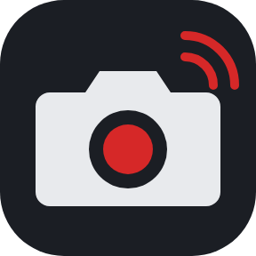
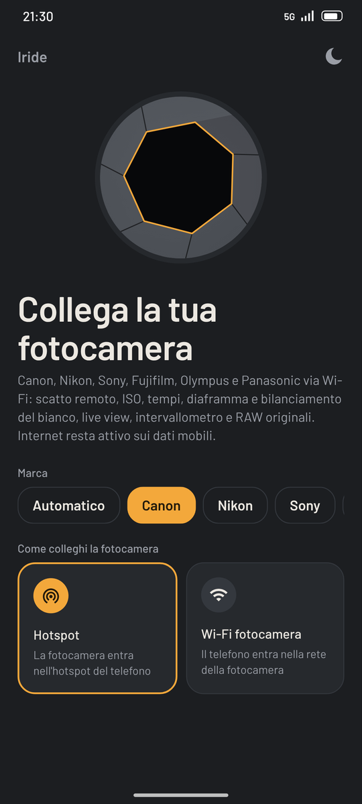
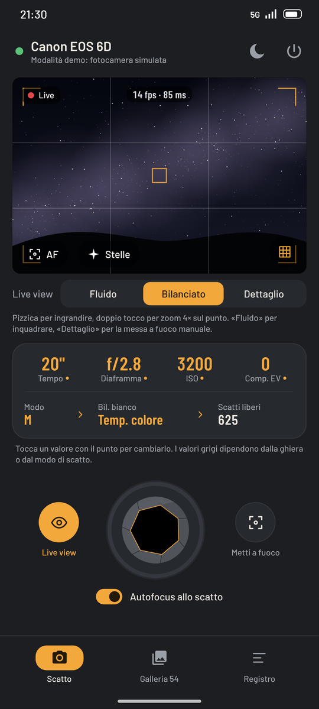
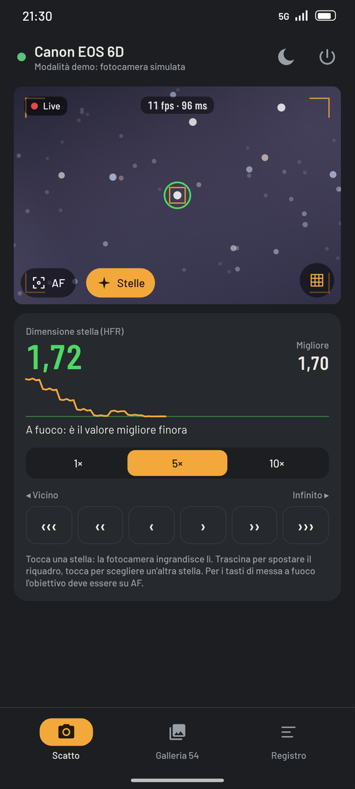
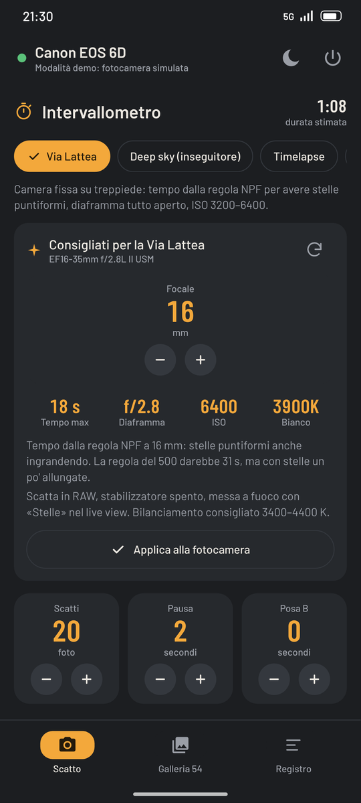
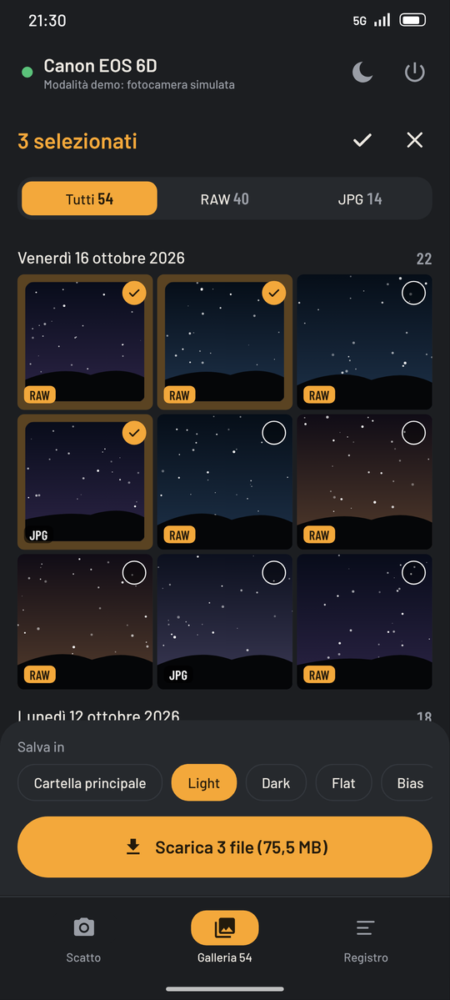
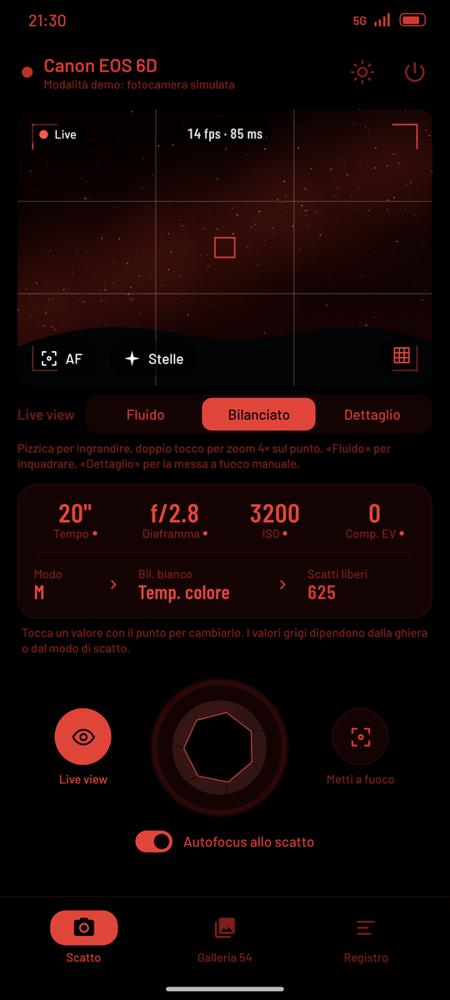

# Iride

**Il telecomando della tua fotocamera: Wi-Fi con i dati mobili sempre attivi, tutte le marche, controllo completo, pensato per il cielo notturno.**

[📖 Guida illustrata (PDF)](docs/guida/Iride_Guida_0.9.pdf) · [🆕 Novità](docs/CHANGELOG.md) · [⬇️ Installare e aggiornare](#installare-e-aggiornare) · [📷 Marche supportate](#marche-supportate)

  
  
  
  
  
  

## Cosa fa

| | Funzione | In breve |
|---|---|---|
| 📶 | **Collegamento** | Hotspot del telefono, stessa rete o Wi-Fi della fotocamera tenuto "locale" all'app: **i dati mobili restano attivi**. Ricerca automatica delle porte o IP manuale |
| 🔌 | **Cavo USB** | Facoltativo, con adattatore OTG: live view quasi istantaneo, stessi comandi del Wi-Fi |
| 🎛️ | **Parametri** | Tempo, diaframma, ISO, compensazione, bianco e modo dal telefono; scatto con autofocus attivabile |
| 🖼️ | **Live view** | Fluido / Bilanciato / Dettaglio, indicatore fps e ritardo, griglia, **istogramma**, **focus peaking**, pizzica per zoom, AF sul mirino |
| 🎚️ | **Bracketing** | 3, 5 o 7 scatti a 1 o 2 EV: tempo in M, compensazione negli altri modi |
| ✨ | **Stelle** | Misura HFR con grafico, zoom 5×/10× sul punto toccato (Canon), passi di messa a fuoco dal telefono |
| ⏱️ | **Intervallometro** | Preset Via Lattea, Deep sky, Timelapse, Dark, Flat, Bias; posa B oltre i 30 s; ritardo iniziale; **continua a schermo spento**, avviso a fine sequenza |
| 🔁 | **Riconnessione** | Se la connessione cade riprova da sola e riprende la sequenza dallo scatto interrotto |
| 🌌 | **Via Lattea** | Dall'obiettivo montato: tempo massimo (regola NPF), diaframma, ISO e bianco, applicabili con un tasto |
| 🗂️ | **Galleria** | Per giorno, filtro RAW/JPG, selezione multipla, **RAW originali** in `Download/Iride/Light·Dark·Flat·Bias` (cartella scelta dal preset) |
| 🌙 | **Notte e demo** | Rosso su nero, live view e miniature compresi, per non perdere l'adattamento al buio; «Prova senza fotocamera» con fotocamera simulata |

## Marche supportate

| Marca | Protocollo | Scatto | Parametri | Live view | Messa a fuoco | Posa B | Galleria |
|---|---|---|---|---|---|---|---|
| Canon EOS | PTP/IP | ✅ | ✅ | ✅ | ✅ + zoom stelle | ✅ | ✅ RAW originali |
| Nikon | PTP/IP | ✅ | ✅ | ✅ | ✅ | ✅ (modo M) | ✅ |
| Sony a7 III / a7 IV e successive | PTP/IP (PC remoto) | ✅ | ✅ | ✅ | ✅ | ✅ | foto scaricate subito |
| Sony meno recenti | API remota HTTP | ✅ | ✅ | ✅ | ✅ | se supportata | anteprima |
| Fujifilm | PTP/IP Fuji | ✅ | ✅ (no tempo) | ✅ | – | – | anteprima |
| Olympus / OM System | HTTP (OI.Share) | ✅ | ✅ | ✅ | – | – | ✅ |
| Panasonic Lumix | HTTP (cam.cgi) | ✅ | – | ✅ | – | – | – |
| Altre PTP/IP | PTP standard | ✅ | se esposti | – | – | – | ✅ |

> **Collaudo:** solo la **Canon 6D** è stata provata su una fotocamera reale (hotspot e Wi-Fi della fotocamera). Gli altri driver seguono libgphoto2 e altri progetti open source e vanno collaudati. Il cavo USB non è ancora stato provato.

## Installare e aggiornare

1. Apri **[Releases](https://github.com/GodEater58/Iride/releases)** dal telefono e scarica l'APK più recente (`Iride-buildN.apk`).
2. Installalo (va permessa l'installazione da origini sconosciute).
3. Le build successive si installano **sopra** la precedente: firma fissa, nessun dato perso.

> ⚠️ Chi aveva la vecchia **EosLink** deve disinstallarla: Iride ha un identificativo diverso.
> Per sequenze lunghe a schermo spento imposta la batteria di Iride su **«Senza restrizioni»** e non chiudere l'app dalle recenti.

## Collegamento consigliato (Canon)

| Passo | Dove | Cosa fare |
|---|---|---|
| 1 | Telefono | Attiva l'hotspot |
| 2 | Fotocamera | Wi-Fi → Attiva → funzione Smartphone → collegati alla rete dell'hotspot |
| 3 | Iride | Marca **Canon**, modalità «Hotspot», **Collega** |
| 4 | Fotocamera | Se chiede di confermare «Iride», premi OK |

Le istruzioni per le altre marche sono nella schermata di collegamento («Come preparare la fotocamera») e nella [guida](docs/guida/Iride_Guida_0.9.pdf).

## Cose da sapere

| Situazione | Cosa sapere |
|---|---|
| Un solo collegamento | Le fotocamere PTP/IP accettano una connessione alla volta: se fallisce (anche la riconnessione automatica), spegni e riaccendi il Wi-Fi della fotocamera |
| Wi-Fi della fotocamera lento | Sulla 6D un RAW può richiedere fino a 20 s; «Fluido» per inquadrare, «Dettaglio» per la messa a fuoco (o il cavo USB) |
| Sony a7 IV e successive | Disattiva l'autenticazione di accesso nel menu Rete |
| Nikon con Wi-Fi integrato (D7200, D750, D5300…) | Scegli la marca Nikon e «Wi-Fi fotocamera»; chiave vuota se non hai messo una password con l'app Nikon; per il live view ghiera su P/A/S/M e tempo diverso da posa B |
| Nikon Z / SnapBridge | L'abbinamento Bluetooth potrebbe impedire il collegamento (non verificato) |
| Fujifilm | Dimensione del live view non regolabile (le fonti non concordano sul codice) |

## Struttura del progetto

| Cartella | Contenuto |
|---|---|
| `app/…/camera/` | Modello comune (`CameraDriver`, esposizione, file), `DriverFactory`, assistente stelle (`StarMeter`), istogramma e peaking (`LiveAnalyzer`), consigli Via Lattea (`SkyAdvisor`), fotocamera demo |
| `app/…/ptp/` | Canale PTP (`PtpTransport`: Wi-Fi `PtpIpClient`, cavo `PtpUsbClient`) e driver Canon, Nikon, Sony, Fujifilm, PTP generico |
| `app/…/http/` | Driver Sony (API remota), Olympus, Panasonic |
| `app/…/net/` | Wi-Fi della fotocamera "locale" all'app, ricerca, Wi-Fi a bassa latenza, `UsbLink` |
| `app/…/ui/` | Interfaccia Jetpack Compose, una schermata per file; `theme/` colori e font Barlow |
| `docs/` | Guida illustrata, novità versione per versione, immagini |
| `scripts/` | Schermate automatiche su emulatore (modalità demo) |
| `LICENSES/` | Licenze dei componenti di terze parti |

## Sviluppo

- Android Gradle Plugin 8.5, Kotlin 1.9, Java 17, SDK 34 (min 29).
- `gradle assembleDebug` — APK di prova.
- Ogni push su `main` compila l'APK e lo pubblica in Releases ([build](.github/workflows/build.yml)).

## Documentazione

- **Per chi usa l'app:** [guida illustrata 0.9](docs/guida/Iride_Guida_0.9.pdf) · [novità versione per versione](docs/CHANGELOG.md)
- **Fonti dei protocolli:** [libgphoto2](https://github.com/gphoto/libgphoto2) · [malc0mn/ptp-ip](https://github.com/malc0mn/ptp-ip) · [olympus-wifi](https://github.com/joergmlpts/olympus-wifi) · [sony_camera_api](https://github.com/Bloodevil/sony_camera_api) · [node-lumix](https://github.com/toddtreece/node-lumix)

## Stato e informazioni legali

Iride è in **fase di test**: progetto personale, non affiliato né approvato da Canon, Nikon, Sony, Fujifilm, OM System o Panasonic, i cui nomi sono marchi dei rispettivi proprietari. Identificativo Android: `it.goletto.iride`.

- **Componenti di terze parti:** [THIRD_PARTY_NOTICES.md](THIRD_PARTY_NOTICES.md) e [LICENSES/](LICENSES/).
- **Dati:** nessun account e nessun server; le foto vanno solo dalla fotocamera al telefono.

Le licenze incluse riguardano solo i componenti di terze parti: nessuna licenza sul codice di Iride è concessa implicitamente.
